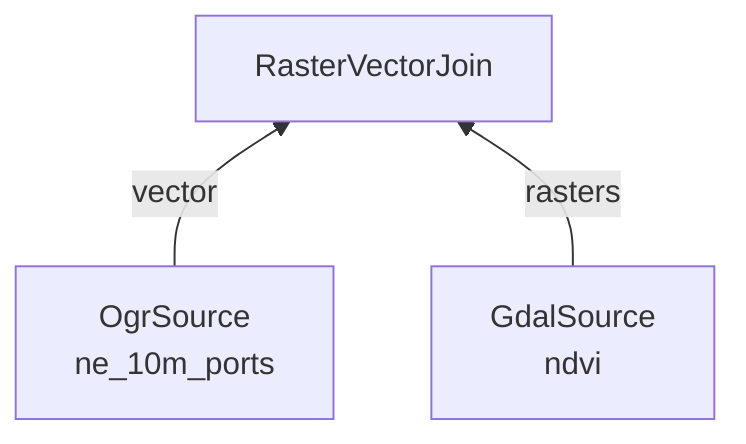

A processing graph describes a computation in Geo Engine.
It is a tree of [operators](/docs/operators/), written in JSON.

## Operators

There are two kinds of operators:

- **Source operators** are the leaves of the tree.
  They have no inputs and load the data that a [data id](/docs/the-geo-engine/datasets) refers to, e.g., [`GdalSource`](/docs/operators/gdalsource) for rasters and [`OgrSource`](/docs/operators/ogrsource) for vectors.
- **Processing operators** take one or more operators as inputs, in their `sources` field, and transform or combine their results.

Every operator has a `type` and its `params`.
The following processing graph joins the values of the `ndvi` raster to the features of the `ne_10m_ports` point dataset:

```json
{
    "type": "Vector",
    "operator": {
        "type": "RasterVectorJoin",
        "params": {
            "names": {
                "type": "names",
                "values": ["NDVI"]
            },
            "featureAggregation": "first",
            "temporalAggregation": "mean",
            "temporalAggregationIgnoreNoData": true
        },
        "sources": {
            "vector": {
                "type": "OgrSource",
                "params": {
                    "data": "ne_10m_ports"
                }
            },
            "rasters": [
                {
                    "type": "GdalSource",
                    "params": {
                        "data": "ndvi"
                    }
                }
            ]
        }
    }
}
```



The outer `type` names the kind of result: `Raster`, `Vector` or `Plot`.
An operator can only be used where its result type fits, e.g., `RasterVectorJoin` expects a vector and one or more rasters as inputs.
The [operator reference](/docs/operators/) lists the inputs, parameters and result of every operator.
[Plots](/docs/plots/) are operators whose result is a chart or a statistic instead of data.

You do not have to write the JSON by hand.
The web apps build processing graphs interactively, and the Python library has a [processing graph builder](/docs/python/processing_graph_builder/operators).

## Registration and ids

Register a processing graph with `POST /processingGraphs` (or `ge.register_processing_graph` in Python).
The response is its id:

```json
{
    "id": "<processing graph id>"
}
```

The id is a UUID v5 hash of the processing graph.
Registering the same processing graph twice yields the same id, and a processing graph is never changed in place.
To change a computation, register a new processing graph.
All other interfaces refer to processing graphs by this id, e.g., the [OGC services](/docs/api/ogc) and [layers](/docs/the-geo-engine/layers).

Registering a processing graph does not compute anything.
Geo Engine evaluates it only when a query arrives; see [Queries and Streams](/docs/the-geo-engine/queries-and-streams).

## Result descriptor

When Geo Engine prepares a processing graph for queries, every operator checks its inputs and describes its result.
These _result descriptors_ propagate from the sources to the root.
Invalid combinations, e.g., inputs with different spatial references, are reported at this point instead of during a query.

Call `GET /processingGraphs/{id}/metadata` to get the result descriptor of the root.
It describes the result by data type, spatial reference, time and spatial extent, and by bands or columns.

### Example response for rasters

```json
{
    "type": "raster",
    "dataType": "U8",
    "spatialReference": "EPSG:4326",
    "time": {
        "bounds": {
            "start": 1388534400000,
            "end": 1404172800000
        },
        "dimension": {
            "type": "regular",
            "origin": 1388534400000,
            "step": {
                "granularity": "months",
                "step": 1
            }
        }
    },
    "spatialGrid": {
        "descriptor": "source",
        "spatialGrid": {
            "geoTransform": {
                "originCoordinate": {"x": -180.0, "y": 90.0},
                "xPixelSize": 0.1,
                "yPixelSize": -0.1
            },
            "gridBounds": {
                "topLeftIdx": {"xIdx": 0, "yIdx": 0},
                "bottomRightIdx": {"xIdx": 3599, "yIdx": 1799}
            }
        }
    },
    "bands": [
        {
            "name": "ndvi",
            "measurement": {
                "type": "continuous",
                "measurement": "vegetation",
                "unit": null
            }
        }
    ]
}
```

`time.dimension` says whether the raster has regular time steps or an irregular time series.
`spatialGrid` is the pixel grid of the result.
See [Time](/docs/the-geo-engine/time) and [Raster and Vector Data](/docs/the-geo-engine/raster-and-vector-data) for details.

### Example response for vectors

```json
{
    "type": "vector",
    "dataType": "MultiPoint",
    "spatialReference": "EPSG:4326",
    "columns": {
        "name": {
            "dataType": "text",
            "measurement": {
                "type": "unitless"
            }
        },
        "scalerank": {
            "dataType": "int",
            "measurement": {
                "type": "unitless"
            }
        }
    },
    "time": {
        "start": -8334601228800000,
        "end": 8210266876799999
    },
    "bbox": {
        "lowerLeftCoordinate": {"x": -171.75795, "y": -54.809444},
        "upperRightCoordinate": {"x": 179.309364, "y": 78.226111}
    }
}
```

`ne_10m_ports` has no time attribute, so its time interval covers all time (see [Time](/docs/the-geo-engine/time)).
`time` and `bbox` are optional for vectors and are `null` if the extent is unknown.

## Provenance and metadata

- `GET /processingGraphs/{id}/provenance` lists the citation, license and URI of every dataset that the processing graph uses.
- `GET /processingGraphs/{id}/allMetadata/zip` returns a ZIP archive with the processing graph, its result descriptor and the provenance.
