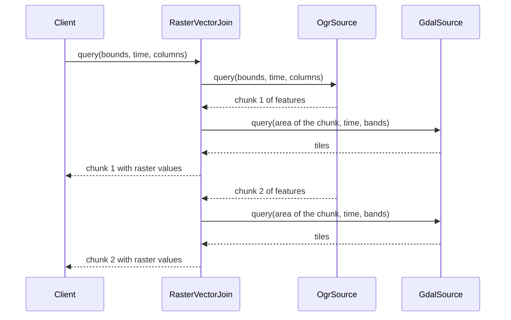
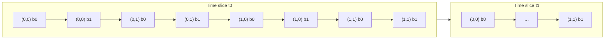

A [processing graph](/docs/the-geo-engine/processing-graphs) is evaluated lazily.
Registering it computes nothing.
Geo Engine loads and processes data only when a query arrives, and only the data that the query needs.
The result is not a single object but a stream: rasters arrive as tiles, vectors as chunks of features.
This is what lets Geo Engine process datasets that are much larger than the available memory.

## Queries

A query asks a processing graph for its result within a _query rectangle_.
A query rectangle has three parts:

- **Spatial bounds.**
  For rasters, these are pixel bounds in the spatial grid of the result (see [Raster and Vector Data](/docs/the-geo-engine/raster-and-vector-data)).
  For vectors and plots, they are a bounding box in the coordinates of the result's spatial reference.
- **Time interval.**
  Only data that intersects this [time interval](/docs/the-geo-engine/time) is returned.
- **Attribute selection.**
  For rasters, this is the list of bands to return.
  For vectors, it is the list of columns.

You rarely write a query rectangle yourself.
The interfaces derive it from their request parameters:

| Interface                                                                       | What it queries                                                                                    |
| ------------------------------------------------------------------------------- | -------------------------------------------------------------------------------------------------- |
| [WMS](/docs/api/ogc#wms) `GetMap`, [OGC API Tiles](/docs/api/ogc#ogc-api-tiles) | A raster for a bounding box, image size, CRS and time, rendered as PNG                             |
| [WCS](/docs/api/ogc#wcs) `GetCoverage`                                          | A raster for a bounding box, resolution, CRS and time, encoded as GeoTIFF                          |
| [WFS](/docs/api/ogc#wfs) `GetFeature`                                           | Vector features for a bounding box and time, as GeoJSON                                            |
| `GET /plot/{id}`                                                                | A plot for a bounding box and time                                                                 |
| `GET /processingGraphs/{id}/rasterStream`                                       | A raster as a stream of tiles over a WebSocket, in Apache Arrow format                             |
| Python library                                                                  | `get_dataframe`, `get_xarray`, `raster_stream`, `vector_stream` and others take a `QueryRectangle` |

When an OGC request asks for a different CRS than the processing graph produces, the service reprojects the result.
For rasters, it also resamples the result onto the requested grid, e.g., to the size of a WMS image.
Inside a processing graph, reprojection is always explicit; see [Spatial References](/docs/the-geo-engine/spatial-references).

## How a query flows through the graph

Every operator is queried in the same way, sources included.
An operator answers a query by querying its inputs, processing their streams and producing its own stream.

The query that an operator sends to an input can differ from the one it received:

- A neighborhood operator needs pixels around the requested area.
- A temporal aggregation needs a longer time interval than the one it outputs.
- A reprojection queries its input in the input's spatial reference.

An operator may also query several inputs at the same time, or the same input several times with different query rectangles.

## Raster streams

A raster result is a stream of _tiles_.
All tiles have the same size, set by `[raster.tiling_specification]` in the server configuration (512 × 512 pixels by default).
The tile size is fixed for the whole runtime of the server.

Raster streams always have the same order and no gaps:

1. **Time** first, ascending.
   The stream delivers all tiles of one time slice before the next slice starts.
   Consecutive slices have no gaps: the end of one slice is the start of the next.
   Sources fill time ranges without data with no-data slices.
2. **Tile position** second.
   Within a time slice, the stream delivers every tile that intersects the query's spatial bounds, row by row, starting with the upper-left tile.
   Tiles without data are delivered as empty tiles.
3. **Band** last.
   For every tile position, the stream delivers one tile per selected band, in the order of the query's band selection.

For example, a query with two time slices, 2 × 2 tiles and the bands `[0, 1]` delivers the tiles in this order:

Because every operator can rely on this order, operators that combine several rasters can process their inputs tile by tile without buffering whole time slices.

## Vector streams

A vector result is a stream of _feature collections_, also called chunks.
Each chunk holds a number of features with their geometries, [time intervals](/docs/the-geo-engine/time) and column values.
Internally, chunks are stored in the columnar [Apache Arrow](https://arrow.apache.org/) format.

Operators aim for chunks of about `[query_context] chunk_byte_size` bytes (1 MiB by default).
A chunk can be smaller than that, e.g., the last chunk of a stream.

## Memory and limits

Operators keep only a bounded number of tiles or chunks in memory to produce their next output.
No operator loads a whole dataset into memory.
Clients can consume results as streams, too: the Python library's `raster_stream` and `vector_stream` process the result piece by piece.

Some interfaces collect a stream into a single response and therefore have limits.
WMS images are at most `[wms] max_image_width` × `max_image_height` pixels, and a WCS response consists of at most `[wcs] tile_limit` tiles.
For large results, use the streaming interfaces or create a dataset from the processing graph with `POST /datasetFromProcessingGraph/{id}`, which runs as a background task.

## Caching

When `[cache] enabled` is set, Geo Engine caches the results of every operator in a processing graph, not only the final result.
A later query whose spatial bounds, time interval and attributes lie within those of an earlier query is answered from the cache.
Each tile and chunk carries a cache hint that controls how long it may be cached.
